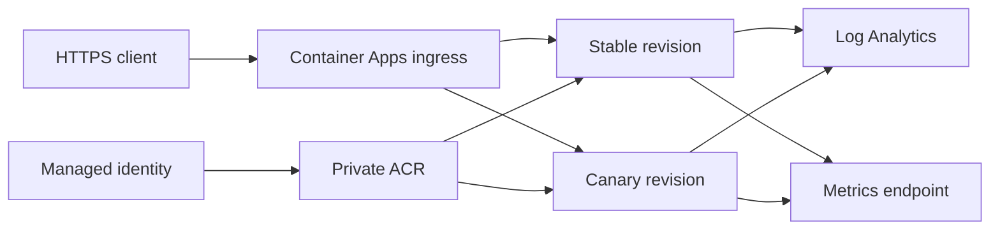
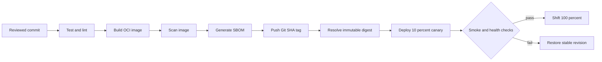

# Secure CI/CD for Azure Container Apps

A compact DevSecOps reference that takes a tested Python API from source to an immutable Azure Container Apps revision using OIDC, reproducible dependencies, SBOM generation, image scanning, canary traffic, and rollback automation.

> Portfolio note: this is a synthetic service and delivery system. It contains no production endpoints, cloud identifiers, credentials, business data, or code copied from a commercial product.

## Delivery capabilities

| Capability | Implementation |
|---|---|
| API | FastAPI with bounded input contracts |
| Operations | Health, readiness, Prometheus metrics and JSON logs |
| Tests | Contract, validation and request-correlation tests |
| Reproducibility | Hash-locked Python dependencies and digest-pinned base image |
| Container hardening | Multi-stage build, non-root runtime, no compiler or package manager in runtime |
| CI | Ruff, mypy, pytest, dependency audit, Hadolint and Trivy |
| Supply chain | SBOM, immutable Git SHA tag and image digest deployment |
| Azure access | GitHub OIDC with environment-scoped permissions |
| Release | Manual canary deployment and deterministic rollback |

## Runtime architecture



The application is intentionally stateless. Azure-managed ingress performs revision traffic splitting, while an existing platform supplies private registry access, identity, logging, and network controls.

## Secure delivery flow



Only a manual deployment workflow can authenticate to Azure. CI triggered by a pull request has read-only repository permissions and no cloud identity.

## Repository layout

| Path | Purpose |
|---|---|
| `src/portfolio_api` | API, structured logging and metrics |
| `tests` | Deterministic application tests |
| `Dockerfile` | Digest-pinned, multi-stage non-root image |
| `requirements.lock` | Hashed runtime dependency closure |
| `requirements-dev.lock` | Hashed validation dependency closure |
| `.github/workflows/ci.yml` | Test, build, scan and SBOM validation |
| `.github/workflows/deploy.yml` | OIDC-authenticated ACR/Container Apps delivery |
| `scripts/deploy-canary.sh` | Create a revision and split traffic |
| `scripts/smoke-test.sh` | Retry-safe release verification |
| `scripts/rollback.sh` | Restore a known revision |
| `docs/wiki` | Reviewable source for GitHub Wiki |

## API contract

| Route | Purpose | Public schema |
|---|---|---|
| `GET /health` | Liveness and version | `status`, `version` |
| `GET /ready` | Readiness | `status` |
| `GET /metrics` | Prometheus metrics | Text exposition format |
| `POST /api/v1/normalize` | Bounded demonstration workload | text up to 500 characters |

The service stores no request payloads and calls no external systems.

## Local development

Prerequisites: Python 3.13 and a virtual environment.

```bash
python3.13 -m venv .venv
source .venv/bin/activate
python -m pip install --require-hashes -r requirements-dev.lock
./scripts/validate.sh

PYTHONPATH=src python -m uvicorn portfolio_api.main:app --reload
```

Then verify `http://127.0.0.1:8000/health` and `http://127.0.0.1:8000/docs`.

## Container build

```bash
docker build --pull --tag portfolio-api:local .
docker run --rm --read-only --tmpfs /tmp --publish 8000:8000 portfolio-api:local
./scripts/smoke-test.sh http://127.0.0.1:8000
```

The base image is pinned to both a Python patch version and the registry manifest digest. Automated dependency updates must replace the digest and rerun the image scan.

## Deployment configuration

| GitHub variable | Example purpose |
|---|---|
| `AZURE_CLIENT_ID` | Federated deployment identity |
| `AZURE_TENANT_ID` | Microsoft Entra tenant |
| `AZURE_SUBSCRIPTION_ID` | Deployment subscription |
| `AZURE_RESOURCE_GROUP` | Existing workload resource group |
| `AZURE_ACR_NAME` | Private Azure Container Registry |
| `AZURE_CONTAINER_APP` | Existing Container App |

These are identifiers, not passwords. Store them as environment-scoped GitHub variables. Configure a distinct federated subject and identity for production.

## Environment strategy

| Environment | Trigger | Initial traffic | Approval |
|---|---|---|---|
| `dev` | Manual | 10% | Optional |
| `stage` | Manual | 10% | Required |
| `prod` | Manual | 5–10% | Required reviewers |

Promotion changes only traffic weights. Rollback does not rebuild the image.

## Security gates

```bash
python -m pip_audit --requirement requirements.lock --disable-pip
hadolint Dockerfile
trivy fs --scanners vuln,secret --severity HIGH,CRITICAL --exit-code 1 .
trivy image --severity HIGH,CRITICAL --exit-code 1 portfolio-api:local
```

GitHub Actions are pinned to full commit hashes, workflows use minimum permissions, and cloud access is limited to the protected deployment job.

## Operational targets

| Indicator | Example target |
|---|---|
| Availability | 99.9% monthly |
| Successful request latency | p95 below 300 ms for the sample endpoint |
| Deployment health | Canary healthy for 5 minutes before promotion |
| Rollback time | Under 10 minutes |
| Error budget policy | Freeze non-essential releases after exhaustion |

Targets are examples, not claims about a deployed service.

## Documentation

The GitHub Wiki contains architecture, CI/CD, supply-chain controls, canary strategy, rollback and operations. Reviewable source pages live in [`docs/wiki`](docs/wiki).

## License

MIT — see [LICENSE](LICENSE).
