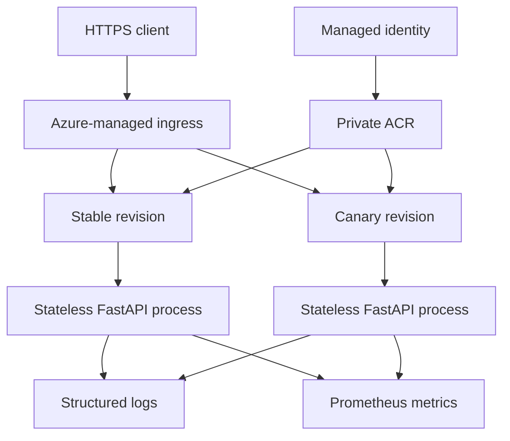

# Architecture

| Component | Responsibility |
|---|---|
| Container Apps ingress | TLS termination, routing and revision traffic |
| Stable revision | Known-good production workload |
| Canary revision | New immutable image under evaluation |
| Managed identity | Passwordless ACR pull and approved service access |
| Log Analytics | Central application and platform telemetry |
