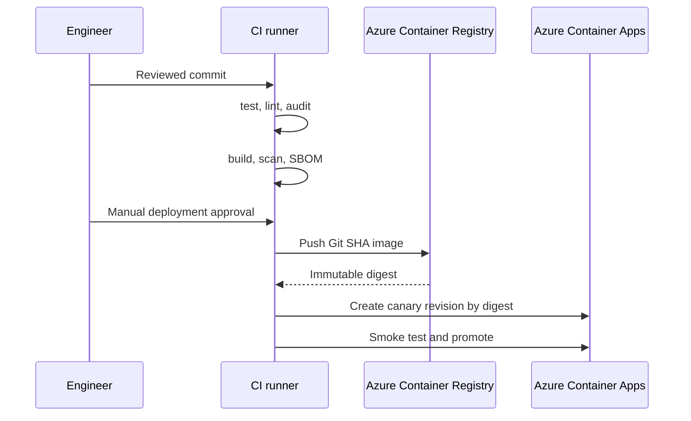

# CI/CD

| Workflow | Trigger | Azure access |
|---|---|---|
| CI | Pull request, main push | None |
| Deploy | Manual dispatch | Environment-scoped OIDC |

Actions are pinned to immutable revisions. The deploy job builds once and deploys the digest returned by the registry push.
