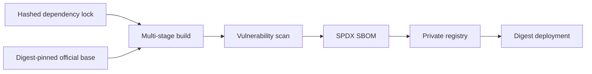

# Container Supply Chain

| Artifact | Integrity control |
|---|---|
| Python packages | Exact versions and package hashes |
| Builder image | Python patch tag plus OCI manifest digest |
| Runtime image | Distroless Python plus OCI manifest digest |
| GitHub actions | Full commit hashes |
| Application image | Git SHA tag and immutable registry digest |
| SBOM | Generated from the built image and retained with CI evidence |
