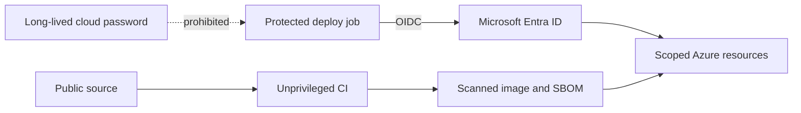

# Security

| Control | Verification |
|---|---|
| Non-root runtime | Dockerfile numeric `USER` |
| Immutable base | Full base image digest |
| Immutable release | Registry digest passed to Container Apps |
| Dependency integrity | Hash-locked requirement files |
| Vulnerability gate | High/critical scan before deployment |
| Cloud authentication | Federated token, protected environment |
